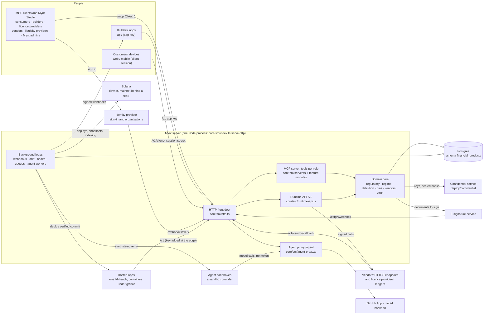
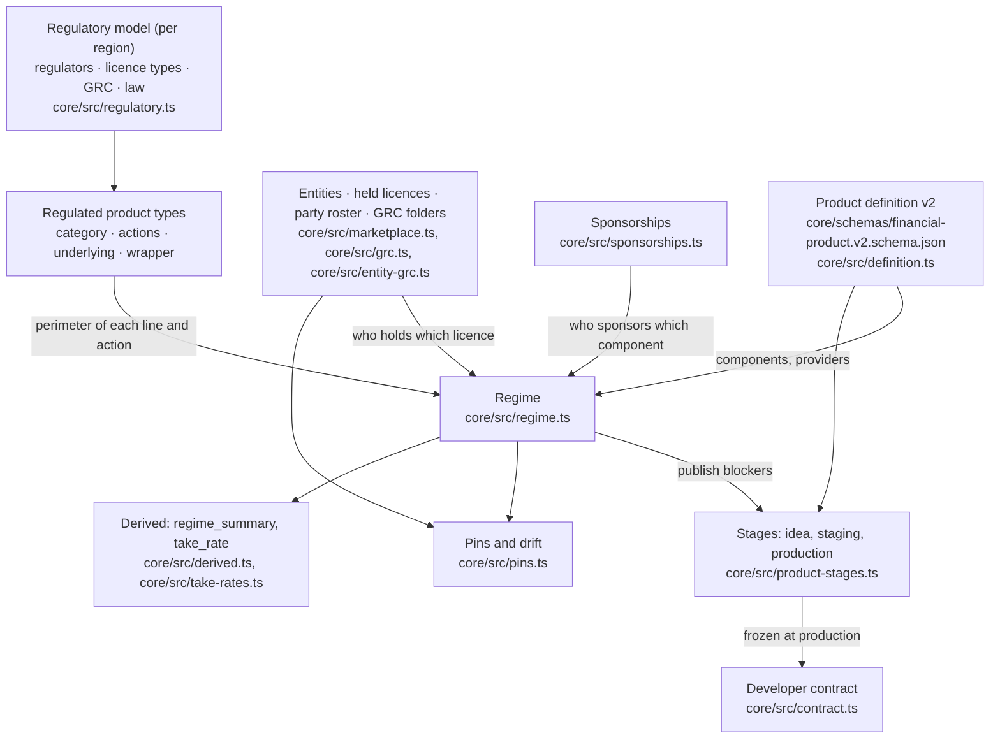
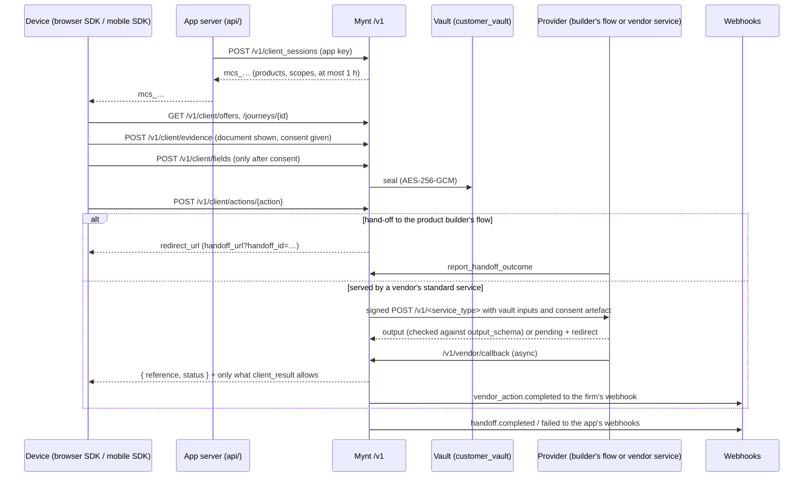

# Mynt architecture

This file is for engineers and coding agents. It explains how Mynt is put together: the parts, how they talk, what they store, and where the trust boundaries are, so you can find where a change belongs.

- **What the product does:** [README](../README.md).
- **Every tool, the runtime API and operations:** the [technical reference](reference.md).
- **Rules for changing the code:** [AGENTS.md](../AGENTS.md).

## The system in one picture



Everything runs in **one Node process** backed by **one Postgres database**. There is no message bus: background work is a set of in-process loops that take their work from Postgres rows. The agent and money workers run through `serialLoop` (`core/src/worker.ts`), which never overlaps itself; the simpler sweeps and indexers are plain timers (see [Background work](#background-work)).

Heavy or untrusted work never runs in that process. Coding agents, model runs, verification and hosted apps run in sandboxes and VMs that Mynt drives through their providers' APIs. Keys that Mynt's own server shouldn't be able to read can live in a separate confidential service.

Mynt has six kinds of user: consumers, builders, licence providers, vendors, liquidity providers and Mynt admins. They reach it through any MCP (Model Context Protocol) client or through Mynt Studio (`platform/studio`), which is itself a client of `/mcp` acting as the signed-in user.

## The HTTP front door

`core/src/http.ts` routes every request by path. Each door has its own authentication, and none of them accepts another's credential.

### MCP

| Path | Who calls it | Authenticates with |
|---|---|---|
| `POST /mcp` | People, through any MCP client or Mynt Studio | With Clerk configured: a Clerk OAuth access token for an invited user. Without Clerk: a local `fpm_` token, or no token for a read-only guest |
| `POST /mcp` | A connector agent run | Its own run token (`Bearer mynt_bd_…`), valid while the run is active. It gets the catalogue tools and the connector's own tools, nothing a person's role would give |
| `/.well-known/oauth-protected-resource*`, `/.well-known/oauth-authorization-server*` | MCP clients discovering sign-in | None. Served only with Clerk configured |

Locally, `mynt serve` speaks MCP over stdio for one user instead (`FINANCIAL_PRODUCTS_TOKEN`).

### The runtime API

`/v1` and everything under it is handed to `core/src/runtime-api.ts`, which routes it further.

| Path | Who calls it | Authenticates with |
|---|---|---|
| `/v1/*` (server routes) | A builder's server (`api/`) | A per-app key (`mynt_live_…` or `mynt_test_…`), stored only as a SHA-256 hash |
| `/v1/client/*` | A customer's browser or phone | A client session secret (`mcs_…`), valid for at most an hour and scoped to products and actions |
| `/v1/vendor/callback/<subscription>` | A vendor finishing an asynchronous action | A `Mynt-Signature` HMAC with the subscription's signing secret |
| `/v1/hosting/bootstrap`, `/v1/hosting/policy`, `/v1/hosting/commands` | A hosted VM's agent, in gateway mode | A one-time bootstrap token, then the tenant's agent token |
| `/v1/ramp-adapters/*` | A ramp partner, for an offering Mynt runs through an adapter | The partner's own webhook signature scheme (`core/src/ramp-adapters/`) |

### Other paths

| Path | Who calls it | Authenticates with |
|---|---|---|
| `/agent/*` | An agent inside its sandbox, reaching the model | A run token that dies with the run (`core/src/agent-proxy.ts`, `core/src/agent-meter.ts`) |
| `POST /webhooks/clerk` | The identity provider, with organization, membership and invitation events | The provider's signature, checked with `CLERK_WEBHOOK_SECRET`. Each event id is handled once. Off when the secret isn't set |
| `/esign/webhook` | The e-signature service | The service's own signature scheme. Each event is handled once |
| `GET /esign/frame-origins` | Mynt Studio | None. It lists the origins signing pages may be framed from, and names no secret |
| `GET /confidential/attestation?nonce=…` | A licence provider checking the confidential service | None. Mynt relays the host's attestation unchanged, with the releases in effect. One request a second across all callers |
| `/ramp-sandbox/*` | Mynt itself, for a ramp offering pointed at the sandbox | Requests Mynt signed (`core/src/ramp-sandbox.ts`) |
| `/vendor-sandbox/<offering id>` | A vendor practising before its own test endpoint exists | Practice requests signed with that offering's conformance secret (`core/src/vendor-sandbox.ts`); never the real conformance test |
| `/bd/unsubscribe` | Anyone the connector emailed | The unsubscribe link itself |
| `GET /llms.txt`, `/.well-known/llms.txt`, `/llms-full.txt` | AI assistants | None. Plain text, no customer data (`core/src/llms-txt.ts`) |
| `GET /` | Anyone | None. One line pointing at `/mcp` and `/llms.txt` |
| `/healthz` | Load balancers | None. It pings the database |

Anything else answers 404 with a line naming the MCP endpoint.

## Roles and tool registration

`createServer(store, user, ctx)` in `core/src/server.ts` builds a fresh MCP server **per signed-in user** and registers only the tools that user's roles allow. A client never sees a tool it can't call.

There are seven roles (`ROLES` in `core/src/store.ts`): `consumer`, `developer`, `innovator`, `vendor`, `license_provider`, `liquidity_provider` and `admin`. `developer` and `innovator` are two names for one role, the builder: each implies the other.

Roles nest (`IMPLIES` and `effectiveRoles` in `core/src/store.ts`):

| Role | Also holds |
|---|---|
| `admin` | builder (so also consumer), `vendor` and `license_provider`. Not `liquidity_provider`: Mynt's staff don't commit capital |
| builder (`developer`, `innovator`) | `consumer` |
| `vendor`, `license_provider`, `liquidity_provider` | Nothing else. They stand beside builders with their own tools only |
| `consumer` | Nothing else |

A guest (no token) gets the read-only catalogue tools. A licence provider's powers also need standing at its firm (`rolesWithStanding` in `core/src/store.ts`).

Each feature module owns its tools and registers them from `server.ts`. Grouped as the reference files are:

| Area | Modules that register tools | Reference |
|---|---|---|
| Catalogue, consumers | `core/src/server.ts`, `core/src/product-requests.ts` | [Roles and tools](reference/roles-and-tools.md) |
| Products | `core/src/server.ts`, `core/src/product-stages.ts`, `core/src/definition-tools.ts`, `core/src/versions.ts`, `core/src/marketplace.ts`, `core/src/product-ideas.ts`, `core/src/desk.ts`, `core/src/explore.ts`, `core/src/take-rates.ts` | [Products](reference/products.md) |
| Apps and builds | `core/src/server.ts`, `core/src/builds.ts`, `core/src/build.ts`, `core/src/app-kinds.ts`, `core/src/app-ideas.ts`, `core/src/repo-approvals.ts`, `core/src/hosting-tools.ts`, `core/src/gtm.ts` | [Apps and builds](reference/apps-and-builds.md) |
| Runtime | `core/src/runtime.ts`, `core/src/journeys-tools.ts`, `core/src/modules.ts` | [Runtime API](reference/runtime-api.md) |
| Workspaces | `core/src/workspaces.ts`, `core/src/promotions.ts`, `core/src/attention.ts`, `core/src/workspace-compliance.ts`, `core/src/workspace-pnl.ts`, `core/src/linked-accounts.ts`, `core/src/chat-sessions.ts` | [Workspaces and sign-in](reference/workspaces-and-sign-in.md) |
| Vendors | `core/src/vendors.ts`, `core/src/vendor-onboarding.ts`, `core/src/ramp-adapters/index.ts` | [Vendors and the marketplace](reference/vendors-and-marketplace.md) |
| Licence providers | `core/src/sponsorships.ts`, `core/src/marketplace.ts` (firms and rosters), `core/src/covenants.ts`, `core/src/partner-kit.ts`, `core/src/product-health-tools.ts`, `core/src/firm-notices.ts`, `core/src/firm-check-tools.ts`, `core/src/regulated-firm-onboarding.ts` | [Firms, licences and licence providers](reference/licence-providers.md) |
| Agreements | `core/src/app-agreements.ts`, `core/src/agreement-esign.ts`, `core/src/esign-settings.ts`, `core/src/agreement-audits.ts`, `core/src/agreement-slas.ts` | [Agreements](reference/agreements.md) |
| Risk | `core/src/risk-register.ts`, `core/src/risk-detail.ts`, `core/src/risk-grading.ts`, `core/src/risk-models.ts` | [Risk](reference/risk.md) |
| Money and liquidity | `core/src/money-rails.ts`, `core/src/liquidity-tools.ts`, `core/src/treasury-tools.ts` | [Money rails](reference/money-rails.md), [Liquidity pools and on-chain treasuries](reference/liquidity-and-treasury.md) |
| Solana | `core/src/solana/tools.ts`, `core/src/solana/mainnet-gate.ts` | [Solana programs](reference/solana-programs.md) |
| Confidential computing | `core/src/confidential/governance.ts` | [Confidential computing](reference/confidential-computing.md) |
| Mynt admins | `core/src/admin.ts`, `core/src/platform-admin.ts`, `core/src/platform-keys.ts`, `core/src/platform-settings.ts`, `core/src/ops.ts`, `core/src/review.ts`, `core/src/bd.ts`, `core/src/app-removal.ts` | [Platform administration](reference/platform-admin.md) |

Some modules register only when their service is configured: hosting, developer modules, the product desk, explorations, coding-agent builds, Solana, the mainnet gate, product health, covenants, the treasury, the connector and the governance desk each come from `ctx`.

`core/src/tool-catalogue.ts` reads the live registry for each role and writes the tool reference the docs site shows (`docs/site/tools.json`); `core/src/llms-txt.ts` does the same for `/llms-full.txt`. Neither is written by hand, so neither can drift from the server.

Every admin action, and every sensitive action by anyone, is written to `audit_log` with who did it. `core/src/audit-classes.ts` gives each entry its class: security, financial, obligations or workspace.

## The domain core

The core turns "a product is a composition of regulated primitives" into data and checks. The rest of Mynt rests on it.



- **Primitives.** A component is a product line (`credit`, `payments`, `exchange` and the rest, in `core/src/catalog.ts`) with an action (`issuance`, `sale`, `purchase`, `servicing` and the rest), in a country, optionally with an `underlying` and a `wrapper`.
- **Perimeter and regime.** `core/src/regime.ts` finds every regulated product type in that country whose category is on the line and allows the action. From that perimeter come the regulators, the licence types that may provide it, and their obligations, filings and controls. GRC is governance, risk and compliance.
- **Coverage.** Licences grant specific actions on specific product types, so coverage is exact, per component and per jurisdiction. A component is covered by the firm's own verified licence or by an approved sponsorship from a licence provider (`core/src/sponsorships.ts`, `core/src/access.ts`). Where a country licenses state by state, a product lists the states it is offered in (`offered_in`, ISO 3166-2 codes like `us-ny`) and coverage is checked in each: a state regulator's licences cover only its state, a national one's the whole country (or what its licence type's `covers` says).
- **Definitions.** A v2 definition (`core/src/definition.ts`) is components joined by typed composition links (`funds`, `settles_into`, `converts_into`, `secures`, `discovers_price_for` and others), each with allowed primitive and action pairs at both ends (`x-from`, `x-to` in the schema). It also holds segments, algorithms, risk models, partner hand-offs, terms, rates, fees, limits, servicing and ACTUS-coded lifecycle events. Upstream records (personas, licences, parties, GRC records) are referenced by connection, never copied.
- **Publishing is promotion.** A product moves through idea, staging and production, one step at a time (`core/src/product-stages.ts`). Staging needs a passing test and opens the product to sandbox builds only. Production publishes it: it needs a passing test of what goes live, a definition that still checks out, a verified licence or approved sponsorship covering every component, and published underlying products. Every check is Mynt's own, from its records.
- **The developer contract.** Going to production freezes the developer contract (`core/src/contract.ts`: offers, actions, consent purposes, documents; never algorithms, costs or parties) with a `contract_hash`, and **pins** the composition and a hash of every entity, licence, party and vendor binding it rests on.
- **Drift.** When any pinned fact changes (a licence lapses, a party ends, a vendor offering is suspended, a firm check fails), the product drifts: new enrolments pause and `product.drifted` goes out, until the state is restored or a new version is published. A state licence's drift names the states it covered; enrolments pause for the whole product, because the runtime can't tell a customer's state. Changes made through Mynt are checked at once; an hourly sweep catches expiries.
- **Derived values.** `regime_summary` and `take_rate` are stored on each product and recomputed whenever anything they rest on changes, so they are cheap to read and always match the live checks.

See [Products](reference/products.md) and [Firms, licences and licence providers](reference/licence-providers.md).

## The runtime path

A shipped app never holds customer financial data, and a device never holds an app key.



- **Evidence** (documents shown, consents given and withdrawn) is stored against the contract version (`client_evidence`).
- **The vault** keeps each customer's fields per app, sealed (`core/src/vault.ts`). Fields are accepted only if an action needs them, after consent, sensitive ones only from a secure input, and every value is validated against the data dictionary (`core/src/data-dictionary.ts`). `DELETE /v1/client/fields` erases everything, including vendor results still queued.
- **Params and quotes.** A vendor-served action may take `params` from the device (an amount, an asset; never customer data) and may be a quote, which another action accepts once, before it expires, by Mynt's reference. Mynt keeps the vendor's quote id.
- **Vendor calls** (`core/src/vendor-call.ts`) go out HTTPS-only to a checked public address, with no redirects, a 10-second limit and a 256 KiB limit, HMAC-signed and replay-protected. Results are sealed, sent in full only to the product's firm, and expire if never finished.
- **Dollars only.** `core/src/dollars-only.ts` refuses any service type that would show a device anything but US dollars.
- **Webhooks** to apps and firms are signed (`Mynt-Signature`), queued in `webhook_deliveries` and retried with backoff by `startWebhookWorker` (`core/src/runtime.ts`).

See [Runtime API](reference/runtime-api.md).

## The agent harness

Every hosted agent runs the same way:

```text
core/workspaces/<agent>/  --copied into-->  agent sandbox  --model calls-->  /agent proxy  -->  model backend
  CLAUDE.md, skills,                          Claude Code, headless,            run token,         metered per run
  subagents, scripts                          job data under job/               spend capped       (agent_spend)
```

- **Steering is data.** An agent's instructions, subagents, skills and scripts live in its agent workspace folder (`core/src/agent-host.ts` copies it in). No agent's instructions are in TypeScript.
- **Sandboxes sit behind one interface.** `SandboxHost` in `core/src/sandbox-host.ts` is what the services use; a sandbox provider is an adapter in `core/src/sandbox-providers/` (`boatdev.ts`, `freestyle.ts`), picked by `sandboxesFromEnv`.
- **No secrets in sandboxes.** The model is reached only through Mynt's proxy with a token that works while the run does. GitHub access is a one-repository installation token for an hour, delivered as a file Mynt refreshes.
- **Spend is metered.** `core/src/agent-meter.ts` prices each model response; sandboxes add machine time. Per-run and monthly caps stop work that passes them. A figure that can't be measured is never shown as $0.
- **Agents never grade their own work.** Each agent's output is checked by Mynt outside its sandbox.

There are eight agent workspace folders under `core/workspaces/`:

| Folder | The agent | What Mynt checks afterwards | Code |
|---|---|---|---|
| `coding-build/` | The coding team | In a fresh sandbox with no secrets: tests, lint, types, `gitleaks`, a dependency audit, a `syft` software bill of materials, a `grype` scan of the images it builds, disclosures, and a re-hash of the source. Mynt opens the pull request | `core/src/builds.ts`, `core/src/verify-script.ts` |
| `build-audit/` | The independent security audit of a build | Runs only with `BUILD_AUDIT=maxwell`. Critical or high findings block the build | `core/src/builds.ts` |
| `product-desk/` | The product desk | Mynt runs the agent's model code itself, in a clean sandbox, and keeps only its own numbers | `core/src/desk.ts`, `core/src/desk-runner.ts` |
| `algorithm-explorer/` | Algorithm explorers | Mynt scores every kept variant on a holdout only it sees | `core/src/explore.ts`, `core/src/explore-score.ts`, `core/src/explore-data.ts` |
| `governance-review/` | The governance desk | Mynt fetches every cited page again, checks each quote, and computes the recommendation. A Mynt admin decides | `core/src/review.ts`, `core/src/evidence.ts` |
| `connector/` | The connector (business development) | Every message goes through one `send()` path that enforces consent, caps, identity and opt-out | `core/src/bd.ts` |
| `program-audit/` | The white-box audit of a Solana program before mainnet | Part of the mainnet program gate, with Mynt's own static analysis and hard rules. A Mynt admin signs off | `core/src/solana/mainnet-gate.ts` |
| `program-red-team/` | The black-box red team of a Solana program before mainnet | Part of the same gate | `core/src/solana/mainnet-gate.ts`, `core/src/solana/gate-scripts.ts` |

See [Coding-agent builds](reference/apps-and-builds.md#coding-agent-builds) and [Agent workspaces](reference/apps-and-builds.md#agent-workspaces).

## Hosting

`core/src/hosting.ts` deploys only builds that passed Mynt's verification.

- **Direct hosting** (`core/src/freestyle.ts` is the adapter): one VM per app. Compose services run under gVisor, read-only, with no capabilities and with CPU and memory limits (`core/src/compose.ts`). Outbound access is only to the app's allow-list (`egressFor` in `core/src/hosting-tools.ts`). Each service gets a public HTTPS route.
- **The key is never on the VM.** The hosting provider's edge adds the app's key on the way out, from a rule only Mynt writes. Mynt honours it only next to the placeholder and never on `/v1/client/*`. That is why an app must never forward callers' requests to Mynt's server-side routes.
- **Gateway mode** (legacy): one VM per builder, reachable only over WireGuard to a gateway on Mynt's host (`deploy/host/hosting-gateway.sh`). The VM's agent talks to `/v1/hosting/*`.
- **Working with a hosted app.** Builders use `app_status`, `app_logs`, `app_run` and `restart_app`, and short-lived SSH logins (`vm_access`). Mynt admins have a kill switch.
- **Usage.** `core/src/usage-meter.ts` samples what each hosted app's VM costs per period, for profit and loss.

See [Hosting](reference/apps-and-builds.md#hosting).

## Workspaces and stages

A workspace is a team that owns apps. With Clerk as the sign-in provider, each workspace is one organization at the identity provider. Mynt's tools write there (`core/src/org-directory.ts` is the interface, `core/src/clerk-orgs.ts` the adapter), and Mynt reads back through the organization webhook and a reconcile worker (`core/src/workspace-sync.ts`). Membership, invitations and offboarding are in `core/src/workspaces.ts`.

An app moves through idea, staging and production only through Mynt's checks (`core/src/promotions.ts`, `core/src/promotion-schema.ts`). Production gates real money. `core/src/attention.ts` lists what needs a workspace's attention, `core/src/workspace-compliance.ts` its licences, obligations and audit trail, and `core/src/workspace-pnl.ts` its profit and loss.

See [Workspaces and sign-in](reference/workspaces-and-sign-in.md).

## Agreements and oversight

An app's workspace holds agreements with the firms behind its products (`core/src/app-agreements.ts`, with kinds, statuses and scopes in `core/src/app-agreements-schema.ts`). Either side proposes and the other accepts. Production needs a signed program agreement with every sponsoring licence provider.

Program agreements can be signed by e-signature. `core/src/esign/provider.ts` is the interface and names no service; `core/src/esign/signwell.ts` is the adapter. A Mynt admin sets it up at run time (`core/src/esign-settings.ts`); its key is a row of the platform key vault (`core/src/platform-keys.ts`), where admins set the server's own keys, sealed by the confidential host and never returned. And `core/src/agreement-esign.ts` runs the signing flow and seals the signed copy.

Under a program agreement, a licence provider runs oversight audits on the app (`core/src/agreement-audits.ts`) and sets service levels (`core/src/agreement-slas.ts`). Risk registers for apps, products and Mynt itself are in `core/src/risk-register.ts`, what a risk holds under it (factors, treatment tasks, controls, links) in `core/src/risk-detail.ts`, how every risk is graded in `core/src/risk-grading.ts`, and Mynt's own risk models in `core/src/risk-models.ts`.

See [Agreements](reference/agreements.md) and [Risk](reference/risk.md).

## Money and liquidity

Mynt never holds customer funds or assets. Money moves off Mynt, on rails a licence provider registered and a Mynt admin approved. Every movement passes one chokepoint, `authorizeMovement` in `core/src/money-rails.ts`: it is refused unless an approved rail fits its direction, the customer's state and its limits, and each movement is a row in the money ledger.

Liquidity providers commit capital to a product's pools (`core/src/liquidity.ts`, `core/src/liquidity-schema.ts`). Withdrawals wait in a queue that a worker pays only as far as the pool's latest verified health snapshot keeps it above its minimum reserve.

Product health is that snapshot (`core/src/product-health.ts`): each product's financial figures, read from the licence provider's ledger through the partner kit (`core/src/partner-kit.ts`, `core/src/partner-ledger/`), encrypted to the firms entitled to read them, and fingerprinted on chain. Licence providers set covenants on those figures (`core/src/covenants.ts`), which can alert or pause a product.

The Mynt Ramp is the one on- and off-ramp for digital-asset liquidity. It is a `ramp` vendor service offered only by the firm a Mynt admin designates with `set_mynt_ramp`; `core/src/ramp-adapters/` holds the adapters and `core/src/ramp-sandbox.ts` its sandbox.

See [Money rails](reference/money-rails.md), [Liquidity pools and on-chain treasuries](reference/liquidity-and-treasury.md) and [Product health](reference/licence-providers.md#product-health).

## On-chain

`core/src/solana/` holds everything that touches Solana.

- **Programs.** `core/src/solana/service.ts` reserves an app's program address, deploys the bytes Mynt itself rebuilt, upgrades, calls and indexes events. The toolchain and its lock pins are in `core/src/solana/toolchain.ts` and `core/schemas/solana-lock-pins.json`.
- **Signers.** `core/src/solana/signer.ts` and `core/src/solana/custody/` decide who signs: a key in Mynt's vault on devnet, and on mainnet whatever a Mynt admin configured.
- **The mainnet program gate.** `core/src/solana/mainnet-gate.ts` reviews every mainnet deploy and upgrade: static analysis, hard rules (`core/src/solana/program-rules.ts`), a vulnerability database (`core/src/solana/vuln-db.ts`), an audit agent and a red-team agent, then a Mynt admin's sign-off and a timelock.
- **Treasuries.** `core/src/treasury.ts` registers pools' on-chain treasuries, prepares unsigned transactions for a person's own wallet, rebuilds the treasury template at each pool's program id, and watches every pool's program, upgrade authority and multisig.
- **Product health.** `core/src/solana/product-health-chain.ts` writes each snapshot's fingerprint on chain.

See [Solana programs](reference/solana-programs.md) and [On-chain treasuries](reference/liquidity-and-treasury.md#on-chain-treasuries).

## Confidential computing

Some things Mynt's own server shouldn't be able to read: the vault's root keys, licence providers' books, and the keys that sign what Mynt attests. They sit behind one interface, `ConfidentialHost` in `core/src/confidential/host.ts`, with three kinds chosen by `CONFIDENTIAL_HOST` (`confidentialHostFromEnv` in `core/src/confidential/index.ts`):

| Kind | What it is |
|---|---|
| `local` | The default. In-process, keyed by `MYNT_VAULT_KEY`. For development, tests, and every server until the operator deploys the confidential service. It attests nothing, and says so |
| `aws-nitro` | The documented deployment: the confidential service in an isolated enclave on a cloud VM (`core/src/confidential/aws-nitro.ts`) |
| `gcp-confidential-space` | Kept as a second adapter: the service as a confidential-VM container (`core/src/confidential/gcp-confidential-space.ts`) |

The service itself is `deploy/confidential`, deployed separately. Mynt reaches it over mutually authenticated TLS whose server key is pinned to the one the hardware attested (`core/src/confidential/remote.ts`). `core/src/confidential/shared/` is code that also runs inside the service. Which builds of the service Mynt trusts is a release record that Mynt admins announce and withdraw (`core/src/confidential/governance.ts`).

See [Confidential computing](reference/confidential-computing.md).

## Data

All state is in one Postgres schema, `financial_products`, created on boot. Tests use PGlite, an in-process Postgres, through the same `Db` interface (`core/src/db.ts`).

There are about 165 tables. `core/src/store.ts` creates the core ones; each feature creates its own, in the file named below. The table names are examples, not the full list.

| Area | Created in | Example tables |
|---|---|---|
| People and access | `core/src/store.ts` | `users`, `invites`, `signup_blocks`, `audit_log`, `settings` |
| Regulatory model | `core/src/store.ts` | `regions`, `regulated_product_types`, `regulator_product_types`, `product_categories`, `take_rates` |
| Firms | `core/src/store.ts` | `entities`, `entity_parties`, `held_licenses`, `grc_records`, `key_vault`, `sponsorships`, `firm_checks`, `firm_notices` |
| Products | `core/src/store.ts`, `core/src/desk.ts`, `core/src/app-ideas-schema.ts` | `products`, `product_versions`, `enrollments`, `requests`, `product_requests`, `product_request_offers`, `product_terms`, `product_ideas` |
| Vendors and the ramp | `core/src/store.ts` | `service_types`, `vendor_offerings`, `vendor_conformance_runs`, `vendor_subscriptions`, `vendor_action_runs`, `vendor_usage`, `ramp_adapter_transfers`, `ramp_link_requests` |
| Apps and runtime | `core/src/store.ts`, `core/src/modules.ts` | `apps`, `app_releases`, `app_journeys`, `api_keys`, `handoffs`, `app_events`, `client_sessions`, `client_evidence`, `customer_vault`, `webhooks`, `webhook_deliveries`, `sdks`, `sdk_modules`, `module_namespaces` |
| Campaigns | `core/src/store.ts` | `segments`, `campaigns` |
| Workspaces and stages | `core/src/workspaces.ts`, `core/src/promotion-schema.ts`, `core/src/chat-sessions-schema.ts` | `workspaces`, `workspace_members`, `workspace_invites`, `workspace_offboards`, `org_webhook_events`, `app_promotions`, `promotion_signoffs`, `chat_sessions` |
| Agreements and risk | `core/src/app-agreements-schema.ts`, `core/src/agreement-esign-schema.ts`, `core/src/agreement-audits-schema.ts`, `core/src/agreement-slas-schema.ts`, `core/src/risk-register-schema.ts`, `core/src/risk-models-schema.ts` | `app_agreements`, `app_target_segments`, `agreement_templates`, `app_agreement_documents`, `agreement_audits`, `agreement_slas`, `risk_register`, `risk_factors`, `risk_treatments`, `risk_controls`, `risk_links`, `risk_grading_versions`, `risk_models` |
| Money and liquidity | `core/src/store.ts`, `core/src/liquidity-schema.ts`, `core/src/covenant-schema.ts`, `core/src/product-health.ts` | `money_rails`, `money_movements`, `customer_verified_states`, `partner_ledger_sources`, `liquidity_pools`, `pool_commitments`, `pool_withdrawals`, `covenants`, `covenant_breaches`, `product_health_snapshots` |
| On-chain | `core/src/solana/service.ts`, `core/src/solana/mainnet-gate.ts`, `core/src/treasury.ts`, `core/src/build-env.ts` | `solana_programs`, `solana_program_versions`, `solana_keys`, `solana_mainnet_reviews`, `treasury_pools`, `treasury_deposits`, `treasury_builds`, `solana_build_envs` |
| Agents | `core/src/builds.ts`, `core/src/agent-meter.ts`, `core/src/desk.ts`, `core/src/explore.ts`, `core/src/review.ts`, `core/src/repo-approvals.ts` | `build_runs`, `build_events`, `agent_spend`, `repo_connections`, `app_repositories`, `desk_jobs`, `desk_workspaces`, `desk_reports`, `explore_jobs`, `explore_variants`, `review_cases` |
| Hosting | `core/src/hosting.ts`, `core/src/usage-meter.ts` | `hosting_tenants`, `hosted_apps`, `hosting_commands`, `usage_samples` |
| Connector | `core/src/bd.ts` | `bd_prospects`, `bd_contacts`, `bd_messages`, `bd_consents`, `bd_intros`, `bd_runs`, `bd_suppressions`, `bd_erasures`, `bd_settings` |
| Confidential computing | `core/src/confidential/governance.ts` | `confidential_releases`, `confidential_keys` |

**What is sealed.** The vault key seals the customer vault, firms' vendor credentials (`key_vault`), queued vendor results, Solana keys, the e-signature key and signed copies of agreements. While the confidential host is `local`, that key is `MYNT_VAULT_KEY`. Once the operator moves it into the confidential service, the service releases a data key into the process at boot, and `MYNT_VAULT_KEY` can be removed from the server. API keys and client session secrets are kept only as hashes.

## Background work

`serve-http` starts these alongside the HTTP server (`core/src/index.ts`). The stdio server starts none of them.

| Loop | Interval | Setting | Does |
|---|---|---|---|
| Build worker | 5 seconds | `BUILD_POLL_MS` | Starts, steers, meters, verifies and finishes coding-agent builds (`core/src/builds.ts`) |
| Product desk worker | 5 seconds | `DESK_POLL_MS` | Runs desk jobs (`core/src/desk.ts`) |
| Exploration worker | 5 seconds | `DESK_POLL_MS` | Runs algorithm explorations (`core/src/explore.ts`) |
| Governance desk worker | 10 seconds | `REVIEW_POLL_MS` | Runs review cases (`core/src/review.ts`) |
| Connector worker | 15 seconds | `BD_POLL_MS` | Runs the connector, when `BD_ENABLED` is set (`core/src/bd.ts`) |
| Mainnet gate worker | 15 seconds | `PROGRAM_GATE_POLL_MS` | Runs mainnet program reviews (`core/src/solana/mainnet-gate.ts`) |
| Webhook worker | 5 seconds | None | Delivers and retries signed webhooks (`core/src/runtime.ts`) |
| Hosting usage worker | 5 minutes | `USAGE_SAMPLE_MS` | Samples what each hosted app's VM costs (`core/src/usage-meter.ts`) |
| Sandbox usage | 5 minutes | `USAGE_SAMPLE_MS` | Samples what ended builds' sandboxes and reopened sandboxes cost. Started with the build worker (`core/src/builds.ts`) |
| Product health worker | 1 minute poll; a snapshot every 60 minutes | `PRODUCT_HEALTH_POLL_MS`, `PRODUCT_HEALTH_INTERVAL_MINUTES` | Publishes each sponsored product's health snapshot. Doesn't run without `PRODUCT_HEALTH_PROGRAM_ID` (`core/src/product-health.ts`) |
| Liquidity worker | 1 minute | `LIQUIDITY_POLL_MS` | Pays pools' withdrawal queues as far as verified health allows (`core/src/liquidity.ts`) |
| Covenant worker | 1 minute | `COVENANT_POLL_MS` | Evaluates licence providers' rules, on its own timer so a rule about missing snapshots can fire (`core/src/covenants.ts`) |
| Workspace reconcile | 15 minutes, backing off to 2 hours while the provider fails | None | Brings workspaces back in step with their organizations (`core/src/workspace-sync.ts`) |
| Workspace sweep | 5 minutes | None | Retries unfinished offboardings, releases invitations that lapsed unanswered, finishes archives (`core/src/workspaces.ts`) |
| Drift sweep | 1 hour | None | Checks every pinned product again; a lapsed licence drifts it (`core/src/pins.ts`) |
| Firm checks | 1 hour poll; each firm every `FIRM_CHECKS_EVERY_DAYS` | `FIRM_CHECKS_POLL_MS` | Checks licence providers' firms again against outside registers (`core/src/firm-check-tools.ts`) |
| Vendor, ramp and movement sweep | 1 minute | None | Expires vendor actions that never finished (`sweepVendorActionRuns`), reads back ramp transfers whose webhook hasn't come, and sweeps stale money movements (`core/src/vendors.ts`, `core/src/ramp-adapters/index.ts`, `core/src/money-rails.ts`) |
| Agreement audits | 1 minute | None | Opens the next oversight audit of each requirement when its time comes (`core/src/agreement-audits.ts`) |
| Solana event indexer | 30 seconds | `SOLANA_INDEX_POLL_MS` | Sends deployed programs' new events to their firms' webhooks (`core/src/solana/service.ts`) |
| Treasury indexer | 30 seconds | `TREASURY_INDEX_POLL_MS` | Reads registered pools' deposits, requests and payments into Mynt's records (`core/src/treasury.ts`) |
| Treasury builds | 1 minute | None | Rebuilds the treasury template at pools' program ids, one at a time |
| Treasury watch | 5 minutes | `TREASURY_WATCH_POLL_MS` | Checks every pool's program, upgrade authority and multisig against what was registered |
| Derived values | Once, on boot | None | Computes `regime_summary` and `take_rate` for products missing them (`core/src/derived.ts`) |

The workers for builds, the desks, explorations, the connector, the mainnet gate, hosting and sandbox usage, product health, liquidity, covenants, firm checks, agreement audits, treasury builds and the treasury watch run through `serialLoop`: a run that is still going when the next is due is skipped, never doubled. The workspace sweep, the drift sweep, the vendor, ramp and movement sweep, the Solana event indexer and the treasury indexer are plain `setInterval` timers with no such guard. The webhook worker has its own guard, and the workspace reconcile schedules its next run only when one ends.

The `serve-http` process also recovers Solana deploys that a previous run of it left unfinished.

## Trust boundaries

| Boundary | What never crosses it |
|---|---|
| Mynt server to agent sandbox | Model credentials, the GitHub App key, any long-lived secret. Agents get a run token and short-lived, single-repository tokens |
| Agent sandbox to shipped code | Anything not checked again by Mynt in a clean sandbox |
| Mynt to hosted app VM | The app's key (added at the edge). The VM reaches only its allow-list |
| App server to device | The app key. Devices get client sessions |
| Device to app database | Customer financial data. It goes to Mynt's vault and to the provider, never the app |
| Mynt to an app's builder | A product's algorithms, risk models, costs, revenue shares and the parties behind it |
| Vendor result to device | Everything except a status, a reference and what `client_result` allows |
| Licence provider's books to Mynt's server | With the confidential service deployed, sealed statements are opened and computed inside it, never in Mynt's process |
| Mynt admin to a firm | A firm's encrypted health books and its signatures. Admins can't read or co-sign them |
| Anything to Mynt's logs and outputs | Secret values and customer data (scrubbed by `core/src/boxes.ts`) |

Mynt itself **never holds customer funds or assets**. Money moves in the licensed firms' own flows; Mynt records consent, evidence and outcomes, and authorises each movement at the chokepoint described under [Money and liquidity](#money-and-liquidity).

## Deployment

- **The server.** `core/Dockerfile` builds the server; `npm run build` in `core/` compiles `core/src/` to `core/dist/`. The server is installed on its own from `core/package-lock.json`. The apps in `platform/` (Mynt Studio, the sample chat, and the sign-in code they share, `platform/packages/auth`) are the repository's npm workspaces.
- **Two paths.** `deploy/setup-vm.sh` runs the server in Docker behind Caddy (`deploy/docker-compose.yml`), joined to a self-hosted Supabase Postgres (`deploy/supabase.override.yml`). `deploy/host/install-host.sh` runs it as a systemd service with one folder per release, backups (`deploy/host/backup.sh`, `restore.sh` and their timers) and, optionally, Mynt Studio on the same domain.
- **The confidential service** is deployed separately from `deploy/confidential`.
- **Settings.** Secrets and infrastructure settings are environment variables, listed in `mynt --help` (`core/src/index.ts`) and in [Settings by name](reference/operations.md#settings-by-name). Each feature turns on when its keys are present and stays off otherwise. Settings Mynt admins change at run time are stored in the database and changed with admin tools: e-signature, public sign-up, the Mynt Ramp's firm, treasury mainnet and the Solana mainnet signer.
- **CI** builds, runs `npm test` in `core/`, tests and builds the `platform/` apps, compiles every generated SDK language, and scaffolds, builds and runs the starter app hardened.

Deployment scripts take domains and addresses as arguments; none is kept in the repository. See [Running Mynt](reference/operations.md).

## Where to make a change

[Where each job lives](../AGENTS.md#where-each-job-lives) in AGENTS.md maps each kind of change to its files and tests. In short:

| Change | Where |
|---|---|
| A tool | Its feature module, wired in `core/src/server.ts` |
| The runtime API | `core/src/runtime-api.ts` |
| Products | `core/schemas/financial-product.v2.schema.json` and `core/src/definition.ts` |
| Regulation | `core/src/regulatory.ts` and `core/src/regime.ts` |
| An agent | Its folder, `core/workspaces/<agent>/` |
| Mynt Studio | `platform/studio/` |
| The docs site | `docs/site/manifest.json`, then regenerate the site data |
