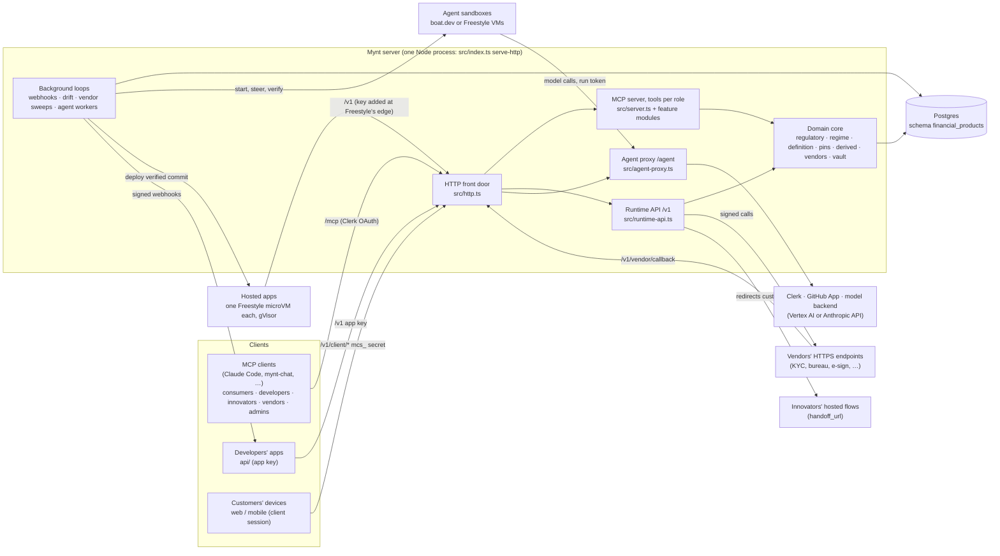
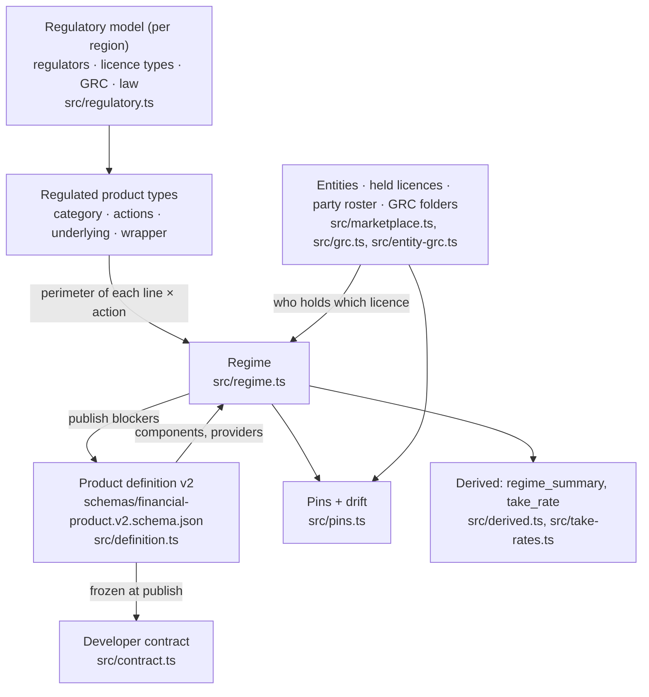
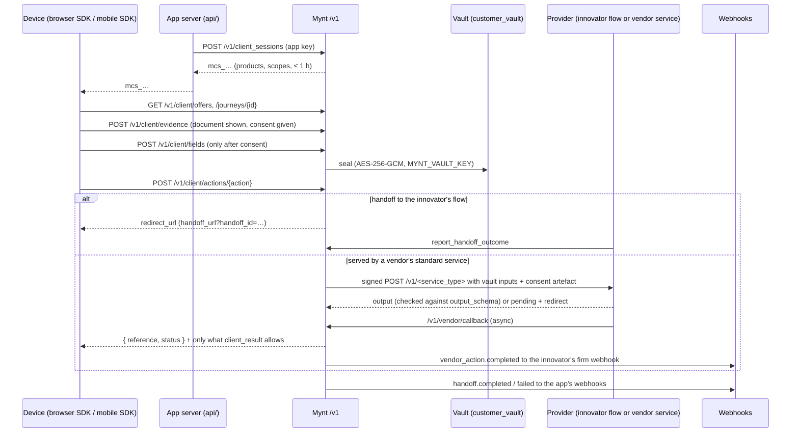

# Mynt architecture

This is how Mynt is put together: the parts, how they talk, what they store, and where the trust boundaries are. The README explains what the product does, and the reference lists every tool. This file explains how it works inside, so you can find where a change belongs.

- **Product view:** [`README.md`](../README.md).
- **Tool and API reference:** [`docs/reference.md`](reference.md).
- **Rules for changing it:** [`AGENTS.md`](../AGENTS.md).

## 1. The system in one picture



Everything runs in **one Node process** backed by **one Postgres database**. There is no message bus: background work is a set of in-process loops that never overlap themselves (`serialLoop` in `src/worker.ts`) and claim their work from Postgres rows. Heavy or untrusted work (coding agents, model runs, verification, hosted apps) never runs in that process. It runs in sandboxes and VMs that Mynt drives through their providers' APIs.

## 2. The three front doors

`src/http.ts` routes every request by path. Each door has its own authentication, and none of them accepts another's credential.

| Path | Who calls it | Authenticates with | Code |
|---|---|---|---|
| `/mcp` | People, through any MCP client | Clerk OAuth (whitelisted users), or a local token in stdio mode | `src/http.ts`, `src/auth.ts`, `src/server.ts` |
| `/v1/*` (server routes) | A developer's server (`api/`) | Per-app key `mynt_live_…` / `mynt_test_…`, stored only as a SHA-256 hash | `src/runtime-api.ts`, `src/runtime.ts` |
| `/v1/client/*` | A customer's browser or phone | Client session secret `mcs_…`, at most an hour, scoped to products and actions | `src/runtime-api.ts` |
| `/v1/vendor/callback/<sub>` | A vendor finishing an asynchronous action | `Mynt-Signature` HMAC with the subscription's secret, 300 s window | `src/vendors.ts` |
| `/v1/hosting/*` | A hosted VM's agent (gateway mode) | One-time bootstrap token, then the tenant's own credentials | `src/hosting.ts` |
| `/agent/*` | A coding or desk agent inside its sandbox | A run token that dies with the run | `src/agent-proxy.ts`, `src/agent-meter.ts` |
| `/bd/unsubscribe` | Anyone the connector emailed | The unsubscribe link itself | `src/bd.ts` |
| `/healthz`, `/.well-known/*` | Load balancers, OAuth discovery | None | `src/http.ts` |

Locally, `mynt serve` speaks MCP over stdio for one user instead.

## 3. Roles and tool registration

`createServer(store, user, ctx)` in `src/server.ts` builds a fresh MCP server **per signed-in user** and registers only the tools that user's roles allow, so a client never even sees a tool it can't call. Roles nest (`effectiveRoles` in `src/store.ts`):

```
admin ⊃ builder (innovator = developer) ⊃ consumer          vendor and license_provider stand beside the builder
```

Each feature module owns its tools and registers them from `server.ts`:

| Module | Tools for |
|---|---|
| `src/server.ts` | catalogue, consumers, enrollments, offers, apps, access requests |
| `src/admin.ts` | regions, product categories, the regulatory model, whitelist, oversight |
| `src/marketplace.ts` | entities, licences, parties, GRC folders, product composition and publishing |
| `src/definition-tools.ts` | v2 product definitions and developer contracts |
| `src/versions.ts` | product versions, diffs, restores, enrollment upgrades |
| `src/vendors.ts` | service types, offerings, conformance, subscriptions, firm webhooks |
| `src/sponsorships.ts` | licence providers' sponsorships of builders' product components |
| `src/runtime.ts` | API keys, webhooks, sandbox hand-offs, releases, app metrics |
| `src/journeys-tools.ts`, `src/modules.ts` | journeys, developer modules |
| `src/gtm.ts` | segments and campaigns |
| `src/build.ts`, `src/builds.ts` | SDKs, experiences, coding-agent builds |
| `src/hosting-tools.ts` | hosting, deploys, app logs and commands, VM logins |
| `src/desk.ts`, `src/explore.ts` | the product desk and algorithm explorations |
| `src/review.ts` | the governance desk |
| `src/bd.ts` | the connector (business development) |
| `src/take-rates.ts`, `src/product-requests.ts`, `src/ops.ts` | take rates, product requests, `ops_status` |

Every admin action, and every sensitive action by anyone, is written to `audit_log` with who did it.

## 4. The domain core

The core turns "a product is a composition of regulated primitives" into data and checks. It's the part the rest of Mynt rests on.



- **Primitives.** A component is a product line (`credit`, `payments`, `exchange`, … in `src/catalog.ts`) with an action (`issuance`, `sale`, `purchase`, `servicing`, …), in a country, optionally with an `underlying` and a `wrapper`.
- **Perimeter and regime.** `src/regime.ts` finds every regulated product type in that country whose category is on the line and allows the action. From that perimeter come the regulators, the licence types that may provide it, and their obligations, filings and controls. Licences grant specific actions on specific product types, so coverage is exact. Where a country licenses state by state, a product lists the states it's offered in (`offered_in`, ISO 3166-2 codes like `us-ny`) and coverage is checked in each: a state regulator's licences cover only its state, a national one's the whole country (or what its licence type's `covers` says).
- **Definitions.** A v2 definition (`src/definition.ts`) is components joined by typed composition links (`funds`, `settles_into`, `converts_into`, `secures`, `discovers_price_for`, …), each with allowed primitive × action pairs at both ends (`x-from`, `x-to` in the schema), plus segments, algorithms, risk models, partner handoffs, terms, rates, fees, limits, servicing and ACTUS-coded lifecycle events. Upstream records (personas, licences, parties, GRC records) are referenced by connection, never copied.
- **Publishing.** `publish_product` needs a verified, in-date licence covering the action, a valid definition with no publish blockers, and passing tests. It freezes the **developer contract** (`src/contract.ts`: offers, actions, consent purposes, documents; never algorithms, costs or parties) with a `contract_hash`, and **pins** the composition and a hash of every entity, licence, party and vendor binding it rests on.
- **Drift.** When any pinned fact changes (a licence lapses, a party ends, a vendor offering is suspended), the product drifts: new enrollments pause and `product.drifted` goes out, until the state is restored or a new version is published. A state licence's drift names the states it covered; sales pause for the whole product, because the runtime can't tell a customer's state. Changes made through Mynt are checked at once; an hourly sweep catches expiries.
- **Derived values.** `regime_summary` and `take_rate` are stored on each product and recomputed whenever anything they rest on changes, so they're cheap to read and always match the live checks.

## 5. The runtime path: from a customer's device to a provider

A shipped app never holds customer financial data, and a device never holds an app key.



- **Evidence** (documents shown, consents given and withdrawn) is stored against the contract version (`client_evidence`).
- **The vault** keeps each customer's fields per app, sealed. Fields are accepted only if an action needs them, after consent, sensitive ones only from a secure input, and every value is validated against the data dictionary (`src/data-dictionary.ts`). `DELETE /v1/client/fields` erases everything, including vendor results still queued.
- **Params and quotes:** a vendor-served action may take `params` from the device (an amount, an asset; never customer data) and may be a quote, which another action accepts once, before it expires, by Mynt's reference. Mynt keeps the vendor's quote id.
- **Vendor calls** (`src/vendor-call.ts`) go out HTTPS-only to a checked public address, with no redirects, 10 s, 256 KiB, HMAC-signed and replay-protected. Results are sealed, sent in full only to the innovator, and expire if never finished (`sweepVendorActionRuns`, every minute).
- **Webhooks** to apps and firms are signed (`Mynt-Signature`), queued in `webhook_deliveries` and retried with backoff by `startWebhookWorker`.

## 6. The agent harness

Every hosted agent (coding team, product desk, algorithm explorers, governance desk, connector) runs the same way:

```
workspaces/<agent>/  ──copied into──►  sandbox (boat.dev or Freestyle VM)  ──model calls──►  /agent proxy  ──►  Vertex AI / Anthropic API
     CLAUDE.md, skills,                  Claude Code, headless,                   run token,                metered per run
     subagents, scripts                  job data under job/                      spend capped              (agent_spend)
```

- **Steering is data.** An agent's instructions, subagents, skills and scripts live in its workspace folder (`src/agent-host.ts` copies it in). No agent's instructions are in TypeScript.
- **No secrets in sandboxes.** The model is reached only through Mynt's proxy with a token that works while the run does. GitHub access is a one-repository installation token for an hour, delivered as a file Mynt refreshes.
- **Spend is metered.** `src/agent-meter.ts` prices each model response; sandboxes add machine time. Per-run and monthly caps stop work that passes them. A figure that can't be measured is never shown as $0.
- **Agents never grade their own work.** Each agent's output is checked by Mynt outside its sandbox:

| Agent | Workspace | What Mynt checks afterwards | Code |
|---|---|---|---|
| Coding team | `coding-build/` | Fresh sandbox, no secrets: tests, lint, types, `gitleaks`, dependency audit, `syft` SBOM, disclosures, then an audit-only run (`build-audit/`) and a re-hash of the source. Mynt opens the PR. | `src/builds.ts`, `src/verify-script.ts`, `src/boat.ts`, `src/freestyle-sandboxes.ts` |
| Product desk | `product-desk/` | Mynt runs the agent's model code itself, in a clean sandbox, and keeps only its own numbers | `src/desk.ts`, `src/desk-runner.ts` |
| Algorithm explorers | `algorithm-explorer/` | Mynt scores every kept variant on a holdout only it sees | `src/explore*.ts` |
| Governance desk | `governance-review/` | Mynt re-fetches every cited page, checks each quote, and computes the recommendation | `src/review.ts`, `src/evidence.ts` |
| Connector | `connector/` | Every message goes through one `send()` path that enforces consent, caps, identity and opt-out | `src/bd.ts` |

## 7. Hosting

`src/hosting.ts` deploys only builds that passed Mynt's verification.

- **Direct on Freestyle** (default with `FREESTYLE_API_KEY`, `src/freestyle.ts`): one Firecracker microVM per app; Compose services under gVisor, read-only, no capabilities, CPU and memory limits (`src/compose.ts`); egress only to the app's allowlist (`egressFor` in `src/hosting-tools.ts`); a public HTTPS route per service. The app's key is **never on its VM**: Freestyle's edge adds it on the way out, from a rule only Mynt writes, and Mynt honours it only next to the placeholder and never on `/v1/client/*`.
- **Gateway mode** (legacy, DigitalOcean): one VM per developer, reachable only over WireGuard to the gateway on Mynt's host (`deploy/host/hosting-gateway.sh`).
- Developers work with a running app through `app_status`, `app_logs`, `app_run` and `restart_app`, and short-lived SSH logins (`vm_access`). Admins have a kill switch.

## 8. Data

All state is in one Postgres schema, `financial_products`, created on boot by `src/store.ts` and the feature modules. Tests use PGlite, an in-process Postgres, through the same `Db` interface (`src/db.ts`). Grouped by job:

| Area | Tables |
|---|---|
| People and access | `users`, `invites`, `signup_blocks`, `audit_log`, `settings` |
| Regulatory model | `regions`, `regulated_product_types`, `regulator_product_types`, `product_categories`, `take_rates` |
| Firms | `entities`, `entity_parties`, `held_licenses`, `grc_records`, `key_vault` |
| Products | `products`, `product_versions`, `product_terms`, `enrollments`, `requests`, `product_requests`, `product_request_offers` |
| Vendors | `service_types`, `vendor_offerings`, `vendor_conformance_runs`, `vendor_subscriptions`, `vendor_action_runs`, `vendor_usage` |
| Apps and runtime | `apps`, `app_releases`, `app_journeys`, `api_keys`, `handoffs`, `app_events`, `client_sessions`, `client_evidence`, `customer_vault`, `test_consumers`, `webhooks`, `webhook_deliveries` |
| SDKs and modules | `sdks`, `sdk_releases`, `sdk_modules`, `module_namespaces` |
| GTM | `segments`, `campaigns` |
| Agents | `build_runs`, `build_events`, `agent_spend`, `repo_connections`, `desk_workspaces`, `desk_jobs`, `desk_reports`, `explore_jobs`, `explore_variants`, `review_cases` |
| Hosting | `hosting_tenants`, `hosted_apps`, `hosting_commands` |
| Connector | `bd_prospects`, `bd_contacts`, `bd_messages`, `bd_consents`, `bd_intros`, `bd_runs`, `bd_settings`, `bd_suppressions`, `bd_erasures` |

Two secrets protect stored data: `MYNT_VAULT_KEY` seals the customer vault, firms' vendor credentials (`key_vault`) and queued vendor results; API keys and client secrets are kept only as hashes.

## 9. Background work

`serve-http` starts these alongside the HTTP server (`src/index.ts`):

| Loop | Interval | Does |
|---|---|---|
| Webhook worker | continuous | Delivers and retries signed webhooks (`src/runtime.ts`) |
| Drift sweep | hourly | Re-checks every product's pins, recomputes derived values (`src/pins.ts`) |
| Vendor action sweep | every minute | Expires vendor actions that never finished (`src/vendors.ts`) |
| Build, desk, explore, review, connector workers | per module | Start, steer, meter, verify and finish agent runs |
| Derived values | on boot | Computes `regime_summary` and `take_rate` for products missing them |

## 10. Trust boundaries

| Boundary | What never crosses it |
|---|---|
| Mynt server → sandbox | Model credentials, GitHub App key, any long-lived secret. Agents get a run token and short-lived, single-repository tokens |
| Sandbox → shipped code | Anything not re-checked by Mynt in a clean sandbox |
| Mynt → hosted app VM | The app's key (added at the edge). The VM reaches only its allowlist |
| App server → device | The app key. Devices get client sessions |
| Device → app database | Customer financial data. It goes to Mynt's vault and to the provider, never the app |
| Mynt → developer | Algorithms, risk models, costs, revenue shares and the parties behind a product |
| Vendor result → device | Everything except a status, a reference and what `client_result` allows |
| Anything → Mynt's logs and outputs | Secret values and customer data (scrubbed by `src/boxes.ts`) |

Mynt itself **never holds customer funds or assets**. Money moves in the licensed providers' own flows (innovators' hosted flows, vendors' services); Mynt records consent, evidence and outcomes. Every transfer Mynt instructs goes through one chokepoint, `authorizeMovement` in `src/money-rails.ts`: it is refused unless an admin-approved rail of the product's licence provider fits its direction, customer state and limits, and each is a row in the money ledger. That includes the **Mynt Ramp**, the one on- and off-ramp for digital-asset liquidity: it is a `ramp` vendor service offered only by the firm designated with `set_mynt_ramp`, today a licensed ramp partner that holds funds in transit under its own licences ([plan](plans/crypto-liquidity.md)).

## 11. Deployment

- **Image:** the root `Dockerfile` builds the server; `npm run build` compiles `src/` to `dist/`.
- **One host:** `deploy/docker-compose.yml` runs the server behind Caddy (automatic HTTPS), joined to a self-hosted Supabase Postgres (`deploy/supabase.override.yml`). `deploy/setup-vm.sh` and `deploy/host/install-host.sh` set a host up; `deploy/host/backup.sh`, `restore.sh` and their systemd timers handle backups and their verification.
- **Configuration** is environment variables only, listed in `mynt --help` (`src/index.ts`) and [`docs/reference.md`](reference.md). Each feature turns on when its keys are present and stays off otherwise.
- **CI** builds, runs `npm test`, compiles every generated SDK language, and scaffolds, builds and runs the starter app hardened.

## 12. Where to make a change

[`AGENTS.md` § Where each job lives](../AGENTS.md#where-each-job-lives) maps each kind of change to its files and tests. In short: tools live in their feature module and are wired in `src/server.ts`; the runtime API in `src/runtime-api.ts`; products in the schema and `src/definition.ts`; regulation in `src/regulatory.ts` and `src/regime.ts`; agents in `workspaces/<agent>/`.
