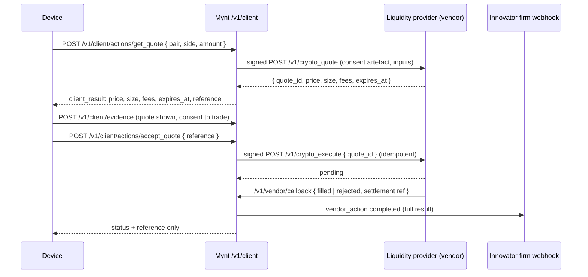

# Plan: connecting Mynt to crypto liquidity

**Status:** decided: the Mynt Ramp, operated by a licensed partner (model R1). The ramp's platform side is built (section 3.2); the partner and the rest are not.
**Reads with:** [`docs/architecture.md`](../architecture.md).
**Scope:** the United States only. Other countries are out of scope for this plan.
**Scope (decided 2026-11-07): USDC only, for now.** Every digital-asset product on Mynt is USDC-based: no other tokens, no crypto trading, no tokenised funds, no third-party bridges. The ramp converts US dollars to and from USDC only, and Circle's CCTP (USDC-only on Solana) covers every cross-chain need (section 3.3). Items below that need anything else are kept, marked "out of scope while Mynt is USDC-only".
**Scope (decided 2026-11-07): developers' customers never see or touch crypto.** No wallets, tokens, chain addresses or "USDC" in any app screen, device SDK result or customer-facing copy: customers see US dollars only. USDC is at most an invisible back-end settlement rail, held by a licensed custodial partner (the Mynt Ramp partner, model R1). Route D (the customer's own wallet signs) is rejected.

## 1. What we want

Developers on Mynt should be able to build apps where a customer can buy, sell, hold, send and borrow against digital assets (crypto, stablecoins and tokenised real-world assets) at **real market prices with real depth**, not a simulated order book. Innovators should be able to compose products that use that liquidity: a stablecoin remittance, a tokenised T-bill savings pot, a loan secured by crypto.

While Mynt is USDC-only (see Scope), what's in scope is dollar products that settle over USDC behind the scenes, through the licensed ramp partner; the customer sees dollars. Crypto buying and holding, tokenised funds and crypto-backed loans are out of scope while Mynt is USDC-only.

## 2. The constraints this plan keeps

These come from how Mynt is already built and from `AGENTS.md`. The plan is shaped around them, not around them being relaxed.

1. **Mynt never holds customer funds, assets or private keys.** Today money moves only in licensed providers' own flows; Mynt records consent, evidence and outcomes. Crypto keeps that: custody and execution sit with a licensed provider, and the Mynt Ramp starts with a licensed partner holding funds in transit (section 3.1, model R1). Changing this is an explicit decision (model R2), not a side effect.
2. **Regulation is data, not code.** Who may offer a digital-asset service in a country is entered into the regulatory model (`define_regulator`, licence types, GRC), verified by the governance desk, and the regime is computed from it. No crypto rule is hard-coded.
3. **Liquidity comes through licensed parties on a firm's roster.** A product component is provided by the owner under its licence, or by an external party on its roster. A crypto exchange, broker, custodian or stablecoin issuer is just such a party.
4. **Vendors are tested by Mynt before they're listed.** A liquidity provider plugged in as a standard service passes Mynt's conformance run first, like every vendor.
5. **Keys stay out of reach.** No app key or provider credential on a device or a hosted VM; devices run on client sessions.
6. **Words.** Customers are customers; firms are innovators and vendors.

## 3. What "real liquidity" can mean, and which route we take

| Route | How it works | Fits Mynt? |
|---|---|---|
| **A. A licensed exchange or broker as the provider** | The innovator *is* (or partners with) a registered virtual-asset service provider. Its product's `exchange` component hands the customer to that provider's hosted flow. | **Yes, works today** with hand-offs. Weak developer experience: no quotes or status inside the app. |
| **B. Liquidity as a vendor standard service** | Admins define US service types (quote, execute, on-ramp, off-ramp, custody balance, address screening, Travel Rule). Licensed liquidity providers implement them; innovators subscribe and bind handoffs to them; Mynt calls them signed and tested. | **Yes, the main route** for the ramp and its USD↔USDC conversion. Reuses the vendor rails (`src/vendors.ts`) and their safety. General liquidity providers and trading (quote, execute on other assets) are out of scope while Mynt is USDC-only. |
| **C. Mynt routes orders on-chain itself** (DEX aggregation, its own wallets) | Mynt signs transactions or holds hot wallets. | **No.** Mynt would be the executing and custodial party, which breaks constraint 1 and would itself need licences. |
| **D. Non-custodial: the customer's own wallet signs** | The provider builds an unsigned transaction or a swap quote; the customer's wallet signs on the device. | **Rejected (2026-11-07).** Customers never see or touch crypto, so there is no customer wallet to sign with. |

**Recommendation:** ship **B**, keep **A** working as the fallback. **D** is rejected. Real depth comes from whichever licensed providers pass conformance: exchanges' brokerage or OTC desks, prime brokers, and regulated stablecoin issuers' mint and redeem. **Fiat in and out goes through one dedicated Mynt Ramp** (section 3.1), so every product and every liquidity provider shares the same on- and off-ramp.

### 3.1 The Mynt Ramp: one on- and off-ramp for all liquidity

Every dollar that enters or leaves digital-asset liquidity on Mynt goes through one ramp that Mynt owns as a platform service:

- **For customers:** one way to fund and cash out in every app (bank transfer, card, wire in; bank transfer out), with one verification and one set of limits, wherever the app is.
- **For developers:** two SDK calls on every product that uses the ramp: get a quote, then accept it. No ramp integration, ever.
- **For liquidity providers:** they settle with the ramp in stablecoins and never touch a customer's bank account. A new provider plugs into one counterparty instead of every app.
- **For Mynt:** one place to price fiat conversion (a ramp fee on top of the take rate), and one place to apply sanctions screening, the Travel Rule and transaction limits.

```
 customer's bank ──fiat──► Mynt Ramp ──stablecoin──► liquidity provider (exchange, broker, issuer)
                 ◄──fiat──           ◄──stablecoin──
                              │
                    one ramp, every product and app
```

**Who holds the money in transit** decides what Mynt becomes, so it's the first decision to make:

| Model | How it works | What it takes | Fits "Mynt never holds funds"? |
|---|---|---|---|
| **R1. Mynt Ramp, operated by a licensed partner** (recommended to start) | The ramp is Mynt's product and brand, with one contract and one API. Underneath, a licensed ramp partner holds the funds in transit and does the transmission, under its own federal registration and state licences. Mynt routes, prices and records. | A partner contract; Mynt registered as a firm in its own model, offering the ramp as a service; weeks, not years | **Yes.** Funds sit with the partner |
| **R2. Mynt Ramp, operated by Mynt** | Mynt itself becomes the money transmitter: it holds customer funds in transit in its own accounts. | Mynt's own FinCEN registration, a money transmitter licence (with bonds, net-worth requirements and exams) in every launch state, and its own anti-money-laundering programme; typically a year or more | **No.** This changes Mynt's core promise, so `AGENTS.md`, the architecture doc and the README would change with it |

R1 can move to R2 later without changing the API developers and providers use: only who stands behind the ramp changes.

**How it fits the code:**
- An admin registers the ramp partner's firm (`register_firm`) and designates it with `set_mynt_ramp`. Only that firm may offer `ramp` service types, so there is exactly one ramp. Every product firm subscribes to it like any vendor service, and the partner joins its roster as a party, so the regime check and drift see the partner's licences. Moving to R2 later is re-designating Mynt's own firm.
- Every digital-asset product composes the ramp: a `payments:sale` component provided by the ramp partner. Cash-out fits as the exchange component `settles_into` the ramp, and funding in as the ramp `funds` the exchange component (the schema now allows `exchange:sale|purchase` as a `funds` target).
- On-ramp and off-ramp are separate pairs, each a quote and its acceptance, with its own consent: `onramp_quote` → `onramp_transfer` (`fiat_onramp`) and `offramp_quote` → `offramp_transfer` (`fiat_offramp`), using the quote → accept flow in section 4.3.
- The ramp's stablecoin settlement with providers is a ledger between firms, reported to each firm by webhook. Customers' balances stay with the provider that holds them.

### 3.2 What's built

| Part | Where | Tests |
|---|---|---|
| The `ramp` service category, the `set_mynt_ramp` admin tool, and the rule that only the designated firm may offer, list or be called for ramp services | `src/vendors.ts` | `test/ramp.test.js` |
| Params: what a device sends with a vendor-served action (amount, asset, direction), declared per service type, scalar only, never customer data | `src/vendors.ts`, `src/runtime-api.ts` | `test/ramp.test.js` |
| Quotes: a quote service's id and expiry kept by Mynt, never shown to the device; accepted once, atomically, only unexpired, only by the same customer and only at the vendor that quoted; released if the call fails | `src/vendors.ts`, `src/store.ts` | `test/ramp.test.js` |
| What the developer contract says (`params_schema`, `quote`, `accepts_quote_from`), and `startAction(…, params, quote)` in every SDK | `src/vendors.ts`, `src/contract.ts`, `src/sdk.ts`, `sdk-templates/` | `test/client-sdks.test.js`; CI compiles Kotlin, Swift and Flutter |
| US on-ramp and off-ramp service types: `onramp_quote`, `onramp_transfer`, `offramp_quote`, `offramp_transfer` | `schemas/service-types/us/` | `test/ramp.test.js` |
| The Mynt Ramp sandbox: a test ramp Mynt serves itself at `/ramp-sandbox`, so both ramps work end to end in sandbox before the partner's live endpoint exists (prices, fees, delayed settlement, returned and failed transfers) | `src/ramp-sandbox.ts`, `src/http.ts` | `test/ramp.test.js` |
| The `digital_assets` underlying, and `funds` into an exchange component | schema, `src/catalog.ts` | `test/us-regulatory-model.test.js` (the USDC template uses both) |
| The US regulatory model as data (FinCEN, NYDFS, California DFPI, OCC, with OFAC, Regulation E and IRS obligations), and a script that applies it to a server | `schemas/regulatory/us.json`, `scripts/apply-regulatory-model.mjs` | `test/us-regulatory-model.test.js` |
| A US USDC account template (ramp funds a USDC purchase held in custody; cash-out back through the ramp) that a licensed firm publishes on that model | `schemas/examples/us/usdc-account.v2.json` | `test/us-regulatory-model.test.js` |
| Research: US ramp partners, shortlist Zero Hash, Bridge, BVNK | `docs/research/us-ramp-partners.md` | |
| Coverage per state: state regulators and their licences scoped to a state, products listing the states they're offered in, publishing blocked per component × state, drift naming the state (section 4.2) | `src/regulatory.ts`, `src/regime.ts`, `src/derived.ts`, `src/pins.ts`, `schemas/regulatory/us.json` | `test/state-coverage.test.js` |

**Not built yet:**
- **The partner's live endpoint.** The partner either implements Mynt's vendor wire contract (`docs/reference.md`) or Mynt runs a small adapter in front of its API. Which one depends on the partner, so it waits for the partner. Sandbox already works without it.
- **Journeys.** A journey step that shows a quote with its expiry before accept.
- **The stablecoin leg** with liquidity providers, and the price and liquidity services behind the exchange component (routes A and B).
- **Ops views:** expired quotes, stuck transfers and returned bank transfers in `ops_status`.

### 3.3 Chains (decided 2026-11-07)

- **USDC only, for now** (see Scope). The ramp converts US dollars to and from USDC; no other token, no crypto trading, no tokenised funds.
- **Solana is the primary chain** for Mynt's digital-asset products. **Base is not used.**
- **Cross-chain moves are USDC through Circle's CCTP V2 only**: native burn-and-mint between Solana (CCTP domain 5) and EVM chains, with no wrapped tokens and no bridge pools ([supported chains and domains](https://developers.circle.com/cctp/expanded-assets/concepts/supported-chains-and-domains), [Solana programs](https://developers.circle.com/cctp/references/solana-programs)). CCTP on Solana carries USDC only (its non-USDC "expanded assets" are EVM-only), which is enough while Mynt is USDC-only. Other assets would cross only by their issuer's native Solana issuance; third-party bridges are avoided, and one is used only if a product needs it, with that decision recorded here.
- **Contract templates are Anchor (Rust) programs.**
- **Mynt never holds keys or signs.** The licensed firm signs through its custody or key-management vendor. Route D (the customer's wallet signs) is rejected.
- **Customers never see or touch crypto.** USDC on Solana (and CCTP across chains) is at most an invisible back-end settlement rail held by the licensed custodial ramp partner (model R1). No wallets, tokens, chain addresses or "USDC" appear in any app screen, device SDK result or customer-facing copy; customers see US dollars. The US USDC account template (`schemas/examples/us/usdc-account.v2.json`) still names USDC in its customer-facing descriptions and must be reworded to dollars before it is offered.
- **Partners must support USDC on Solana:** the ramp partner and the address-screening and Travel Rule vendors, to be confirmed per partner.

## 4. How it fits the existing model

### 4.1 Primitives and compositions

Digital assets already belong on the `exchange` line (`src/catalog.ts`: "commodities and bullion trading, digital assets"). Custody belongs on `custody_settlement`; stablecoin payments on `payments`. Example compositions, using the link types the schema already has:

Each row below uses only links whose ends the schema allows today (`x-from` and `x-to` in `schemas/financial-product.v2.schema.json`):

| Product | Components | Links |
|---|---|---|
| Buy and hold crypto (*Out of scope while Mynt is USDC-only.*) | `exchange:sale` (broker executes) + `custody_settlement:servicing` (custodian holds) | exchange `settles_into` custody |
| Stablecoin cross-border transfer | `exchange:sale` (fiat → stablecoin) + `payments:sale` (send) | exchange `converts_into` payments. `converts_into` requires a `cash` underlying today, so this depends on how stablecoins are classified (section 4.2). The far-end off-ramp is the receiving provider's own product |
| Tokenised T-bill savings pot (*Out of scope while Mynt is USDC-only.*) | `payments:sale` (on-ramp funding) + `wealth:purchase` (tokenised fund unit) + `custody_settlement:servicing` | payments `funds` wealth; custody `services` wealth |
| Crypto-backed loan (*Out of scope while Mynt is USDC-only.*) | `credit:issuance` + `custody_settlement:servicing` (collateral held) + `payments:sale` (repayments) | custody `secures` credit; credit `repays_from` payments |

The regime check then does what it does for any product: it finds the regulated product types in the perimeter, the licences that may provide each part, and blocks publishing if the provider doesn't hold one.

### 4.2 Gaps in today's code

| Gap | Where | Change |
|---|---|---|
| ~~No `digital_assets` underlying~~ (done), so a crypto exchange component couldn't be told apart from FX or bullion | `UNDERLYINGS` in `src/catalog.ts`, the schema's `underlying` enum | Add `digital_assets` (and decide whether stablecoins are `cash` with a `wrapper`, or their own underlying) |
| A stablecoin is neither clearly `cash` nor a new underlying, and `converts_into` accepts only `cash` | Schema `conn_converts_into`, `src/definition.ts` | Decide the classification; if stablecoins get their own underlying, widen `converts_into` to accept it |
| Nothing settles out of an exchange into another exchange component, and `discovers_price_for` can't target one, so a crypto venue or a two-leg swap can't be composed | Schema `x-from` / `x-to` | Extend the allowed ends only if a first product needs it |
| ~~A payment can't fund an exchange component~~ (done) | Schema `conn_funds` `x-to` | `exchange:sale\|purchase` is now an allowed end of `funds` |
| Vendor categories are data services only | `SERVICE_CATEGORIES` in `src/vendors.ts` | Add `liquidity` (quote, execute), `ramp` (on/off), `custody` (balance, withdrawal), `chain_compliance` (address screening, Travel Rule) |
| ~~The vendor contract is a single request and answer, with no notion of a firm price~~ (done: params and quotes) | `src/vendor-call.ts`, the wire contract in `docs/reference.md` | A two-step **quote → accept** pattern: a quote carries a price, size, expiry (seconds) and quote id; accept is idempotent on the quote id and refused after expiry. Built on the existing async callback for settlement status |
| Price changes between showing and accepting | Developer contract, journeys | A `quote` step type in journeys and a device-visible `client_result` for quotes (price, size, expiry, fees: never the provider's internal data) |
| No wallet address or chain data field | `src/data-dictionary.ts` | Add `wallet_address`, `chain_network`, `destination_tag`, with validation per network. Since customers never touch crypto, these are not customer fields: only firm- or partner-side, if ever needed |
| Wallet address validation doesn't cover Solana | `src/data-dictionary.ts` (planned fields above) | If `wallet_address` / `chain_network` are added, validate Solana addresses (base58 public keys) as well as EVM ones, since Solana is the primary chain (section 3.3) |
| No Travel Rule data for transfers | Data dictionary, service types | Originator and beneficiary fields, sent only to a `chain_compliance` service with consent |
| ~~Coverage is checked per country, so one licence anywhere in the US counts as covering every customer~~ (done). US money transmission and virtual-currency business are licensed **state by state** | `productRegime` in `src/regime.ts`, `src/regulatory.ts`, `src/derived.ts`, `src/pins.ts`, `schemas/regulatory/us.json` | Built as described under "Coverage per state" below |
| Lifecycle events for on-chain settlement | Schema `lifecycle_event` | Reuse ACTUS `STD` (settlement) and `AD` (monitoring); add confirmation depth as a term, not an event code |
| Take rate basis for trading | `src/take-rates.ts` | Confirm a `volume` basis covers notional traded; no new mechanism expected |
| Sandbox liquidity | Vendor test endpoints | Providers' test endpoints (testnet or paper trading) are the sandbox; conformance fixtures include a quote that expires and an accept after expiry that must be refused |

#### Coverage per state (built)

- **Jurisdiction codes** are ISO 3166-2, lowercase like entities' incorporation codes: `us-ny`, `us-ca`. A country code alone (`us`) means the whole country.
- **Regulators**: a state regulator carries `jurisdiction` (NYDFS `us-ny`, DFPI `us-ca`); a federal one (FinCEN, OCC) has none and is country-wide.
- **Licence types** may declare `covers`: a list of codes, or `["us"]` for the whole country, e.g. a federal charter taken to pre-empt state licensing for what it grants. Without it a licence covers its regulator's jurisdiction (its state, or the whole country). `coverage_note` records the basis and what is still to verify. A type issued separately in many states sets `issued_per_jurisdiction: true` with `covers` listing those states; each held licence then records the `jurisdiction` it was issued for (`register_license … jurisdiction: "us-tx"`, a new nullable column on held licences), so a firm can hold one per state.
- **Products** list where they're offered: `offered_in` on the v2 definition (copied onto each component of that country) or on a component in `compose_product`, e.g. `["us-ny", "us-ca"]`, or `["us"]` for the whole country (which needs a licence covering all of it). Without `offered_in`, a component is checked for its country as a whole, exactly as before, so regions without states are unchanged.
- **The regime** checks each component in each offered state: covered when the provider (the owner, or a partner on the roster) holds a verified, in-force licence that grants it and covers that state. Each component gets a row per state; `blockingComponents` lists component × state with a reason such as "In us-ca: Your entity's licences granting this cover nydfs_bitlicense (us-ny), not us-ca; needs one covering us-ca: ca_dfpi_dfal". Mandated stakeholders are checked per covering licence, as before.
- **Stored `regime_summary`** gains `jurisdictions` per region (each offered state, covered or not) and per component (coverage and blocker per state). Panes that read it as-is keep working; the fields are additive.
- **Drift**: every licence that covers a state is pinned at publish, with the states it covers. When one lapses or is suspended, the drift change names those states, and new sales pause **for the whole product**, with a drift note saying why: Mynt's runtime can't reliably tell a customer's state when a sale starts (a session may carry no customer, and the vault no address). Pausing one state would need the customer's state at sale time.
- **The US model** (`schemas/regulatory/us.json`) scopes NYDFS and DFPI to their states. The FinCEN registration and the two OCC charters cover `us`; each says in its `coverage_note` that this is an assumption to verify. The FinCEN one matters most: in law it doesn't replace state money transmitter licences, so it should be narrowed once state money transmitter licence types are modelled. To add a state, add its regulator with `jurisdiction: "us-xx"`, its licence types and the law they cite, from the state's own sources.

### 4.3 The quote → accept flow



Customer money and assets move only in the provider's accounts. Mynt holds the evidence that the exact quote was shown and accepted, which is what a dispute or an inspection needs.

## 5. The regulatory model to enter

None of this goes in as code. Each item becomes data through `define_regulator` and the governance desk's review, with sources, the way [`docs/research/licence-gaps.md`](../research/licence-gaps.md) records them. These are **starting points to research**, not verified facts; each must be confirmed against the regulator's own text, and statuses may have changed.

| Layer | What to research and model |
|---|---|
| Federal anti-money-laundering | FinCEN money services business registration; Bank Secrecy Act programme, suspicious activity and currency transaction reporting; the funds Travel Rule (31 CFR 1010.410(f)); FinCEN's guidance on convertible virtual currency |
| Sanctions | OFAC screening of customers and wallet addresses, as an obligation served by an `address_screening` service |
| Federal market regulators | Which tokens the SEC treats as securities and which the CFTC treats as commodities, and what that means for who may offer `exchange:sale` on each (broker-dealer, alternative trading system, futures commission merchant, or neither) |
| Stablecoins | The federal payment-stablecoin law (the GENIUS Act, 2025) and its implementing rules: who may issue, reserve and redemption requirements, and what that means for a product that holds or sends them |
| States | Money transmitter licences in each state, the states that have adopted the Money Transmission Modernization Act, and New York's BitLicense (23 NYCRR Part 200) and limited-purpose trust charter. Each state regulator becomes a regulator in the model, scoped to its state (section 4.2) |
| Consumer protection | The CFPB Remittance Transfer Rule (Regulation E, subpart B) for consumer cross-border transfers, including stablecoin remittances; state unfair and deceptive practice rules for promotion |
| Tax | IRS broker reporting of digital-asset sales on Form 1099-DA, as a provider obligation and a customer disclosure |

For each: the regulator, the licence types and what they grant on which regulated product types, mandatory stakeholders, obligations and filings (suspicious transaction reporting, Travel Rule, proof of reserves where required), and required disclosures and banned claims for campaigns (crypto promotion rules are strict; `lint_campaign` should get them as data).

## 6. Phases

Each phase ends with something that runs and is checked by tests, and changes nothing live without an explicit yes.

**Phase 0: research and decisions (no code).**
- Confirm the first two or three products and the states to launch in.
- Research the regulatory items in section 5, with sources, into `docs/research/`.
- Shortlist US liquidity, ramp and custody providers that already hold the federal registration and the state licences (or a trust charter) for the launch states, and are willing to implement Mynt's vendor contract. Partnering with licensed providers is what makes a multi-state launch possible without holding every licence yourselves.

**Phase 1: model it.**
- Done: the `digital_assets` underlying, and state-scoped regulators and coverage per state (section 4.2).
- The US regulated product types and licence types (federal and the launch states), entered by an admin and reviewed by the governance desk.
- A seed definition (like `schemas/examples/seed/`) for one product, "buy and hold crypto", checked with `check_product_definition`.
- Tests: `test/regulatory.test.js`, `test/regime.test.js`, `test/definition.test.js` with a US digital-asset slice (federal plus two states) in a test regulatory model, including a product blocked in a state with no covering licence.
- Route A works at the end of this phase: a licensed provider's hosted flow behind a hand-off.

**Phase 2: the Mynt Ramp, then liquidity as a vendor service.**
- Choose R1 or R2 (section 3.1) and, for R1, the ramp partner.
- Done: the designated ramp firm, the on-ramp and off-ramp service types, the sandbox ramp, and quote → accept client actions in every product that composes the ramp.
- Done: tests for an on-ramp, an off-ramp, an expired quote and a returned bank transfer. Still to do: a sanctions hit, once address screening exists.
- New service categories and example service types as JSON in `schemas/service-types/us/` (`fiat_onramp`, `fiat_offramp`, `custody_balance`, `address_screening`, `travel_rule`; `crypto_quote` and `crypto_execute` for trading are out of scope while Mynt is USDC-only).
- The quote → accept pattern in `src/vendor-call.ts` and `src/vendors.ts`: quote expiry, idempotent accept, settlement by callback, conformance cases for each.
- New data dictionary fields; `client_result` for quotes.
- Tests: `test/vendors.test.js`, `test/vendor-actions.test.js`, with a fake provider covering expiry, replay, a schema-breaking answer and a withdrawn consent.

**Phase 3: developer experience.**
- A `quote` journey step and its checks in `src/journeys.ts` (a quote must be shown, with its expiry, before accept; consent before both).
- SDK support in every language (`sdk-templates/`) and a starter-app example in `workspaces/coding-build/templates/mynt-app/`.
- Coding team guidance in `workspaces/coding-build/` (vendored skills only, per `AGENTS.md`).
- Tests: `test/journeys.test.js`, `test/client-sdks.test.js`; CI's starter-app job.

**Phase 4: first live provider (needs explicit yes).**
- A provider passes conformance against its test endpoint; an innovator with the right licence subscribes; a product is published; a pilot app is built, verified and hosted.
- Ops: `ops_status` shows failed quotes, expired accepts and stuck settlements per subscription.

**Phase 5: later.**
- ~~Non-custodial signing on the device (route D)~~: rejected, customers never touch crypto.
- Crypto-collateralised credit, with price feeds as an `information` service and margin calls as lifecycle events. *Out of scope while Mynt is USDC-only.*
- Tokenised real-world assets as `wealth` products. *Out of scope while Mynt is USDC-only.*

## 7. Risks

| Risk | Mitigation |
|---|---|
| Mynt drifting into custody or execution | Route C is out of scope; under ramp model R1, reviews of every phase check that no key, balance or order book sits in Mynt |
| One ramp is a single point of failure | The ramp partner's licences are pinned, so a lapse pauses sales instead of failing mid-transfer; R1 can add a second partner behind the same API |
| A provider's licence lapses or it's suspended mid-trade | Already handled: vendor bindings are pinned, so products drift and new sales pause; open actions finish or expire |
| Stale prices | Quotes expire in seconds; accept after expiry is refused by the provider and checked in conformance |
| A state with no covering licence | Coverage per state blocks publishing for that state; when a state licence lapses, drift names the state and pauses new sales of the whole product (the runtime can't tell a customer's state) |
| Misleading promotion | Crypto promotion rules entered as banned claims and required disclosures, enforced by `lint_campaign` and `check_experience` |
| Sanctions and illicit-finance exposure | Address screening and Travel Rule as required services in the regime for transfer products |
| Regulatory change | Regulation is data; a change is a model update that recomputes every product's regime and drifts those it affects |

## 8. Questions for the operator

1. Which states first? A few large ones, or everywhere a partner is already licensed?
2. Which first product: buy and hold, stablecoin remittance, or a tokenised T-bill pot?
3. Will you hold US licences yourselves, or will innovators bring theirs?
4. Are there liquidity or ramp providers you already talk to who could implement the vendor contract?
