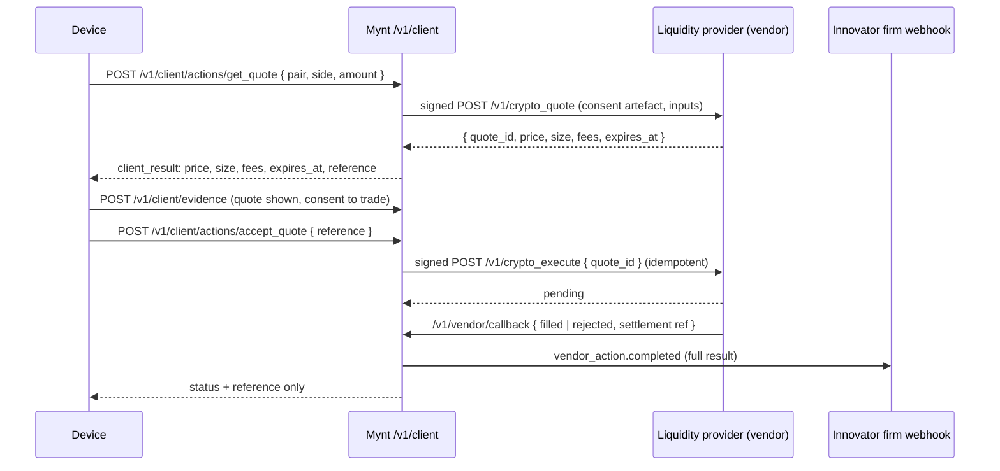

# Plan: connecting Mynt to crypto liquidity

**Status:** draft for discussion. Nothing here is built yet.
**Reads with:** [`docs/architecture.md`](../architecture.md).
**Scope:** the United States only. Other countries are out of scope for this plan.

## 1. What we want

Developers on Mynt should be able to build apps where a customer can buy, sell, hold, send and borrow against digital assets (crypto, stablecoins and tokenised real-world assets) at **real market prices with real depth**, not a simulated order book. Innovators should be able to compose products that use that liquidity: a stablecoin remittance, a tokenised T-bill savings pot, a loan secured by crypto.

## 2. The constraints this plan keeps

These come from how Mynt is already built and from `AGENTS.md`. The plan is shaped around them, not around them being relaxed.

1. **Mynt never holds customer funds, assets or private keys.** Today money moves only in licensed providers' own flows; Mynt records consent, evidence and outcomes. Crypto keeps that: custody and execution sit with a licensed provider.
2. **Regulation is data, not code.** Who may offer a digital-asset service in a country is entered into the regulatory model (`define_regulator`, licence types, GRC), verified by the governance desk, and the regime is computed from it. No crypto rule is hard-coded.
3. **Liquidity comes through licensed parties on a firm's roster.** A product component is provided by the owner under its licence, or by an external party on its roster. A crypto exchange, broker, custodian or stablecoin issuer is just such a party.
4. **Vendors are tested by Mynt before they're listed.** A liquidity provider plugged in as a standard service passes Mynt's conformance run first, like every vendor.
5. **Keys stay out of reach.** No app key or provider credential on a device or a hosted VM; devices run on client sessions.
6. **Words.** Customers are customers; firms are innovators and vendors.

## 3. What "real liquidity" can mean, and which route we take

| Route | How it works | Fits Mynt? |
|---|---|---|
| **A. A licensed exchange or broker as the provider** | The innovator *is* (or partners with) a registered virtual-asset service provider. Its product's `exchange` component hands the customer to that provider's hosted flow. | **Yes, works today** with hand-offs. Weak developer experience: no quotes or status inside the app. |
| **B. Liquidity as a vendor standard service** | Admins define US service types (quote, execute, on-ramp, off-ramp, custody balance, address screening, Travel Rule). Licensed liquidity providers implement them; innovators subscribe and bind handoffs to them; Mynt calls them signed and tested. | **Yes, the main route.** Reuses the vendor rails (`src/vendors.ts`) and their safety, adds what trading needs. |
| **C. Mynt routes orders on-chain itself** (DEX aggregation, its own wallets) | Mynt signs transactions or holds hot wallets. | **No.** Mynt would be the executing and custodial party, which breaks constraint 1 and would itself need licences. |
| **D. Non-custodial: the customer's own wallet signs** | The provider builds an unsigned transaction or a swap quote; the customer's wallet signs on the device. | **Later, as a variant of B.** Needs wallet-signing support in the device SDKs and a regulatory view per region on unhosted wallets. |

**Recommendation:** ship **B**, keep **A** working as the fallback, and treat **D** as a later phase. Real depth then comes from whichever licensed providers pass conformance: exchanges' brokerage or OTC desks, prime brokers, regulated stablecoin issuers' mint and redeem, and on- and off-ramp providers. Mynt can list several and an innovator chooses, so Mynt never becomes a single point of liquidity.

## 4. How it fits the existing model

### 4.1 Primitives and compositions

Digital assets already belong on the `exchange` line (`src/catalog.ts`: "commodities and bullion trading, digital assets"). Custody belongs on `custody_settlement`; stablecoin payments on `payments`. Example compositions, using the link types the schema already has:

Each row below uses only links whose ends the schema allows today (`x-from` and `x-to` in `schemas/financial-product.v2.schema.json`):

| Product | Components | Links |
|---|---|---|
| Buy and hold crypto | `exchange:sale` (broker executes) + `custody_settlement:servicing` (custodian holds) | exchange `settles_into` custody |
| Stablecoin cross-border transfer | `exchange:sale` (fiat → stablecoin) + `payments:sale` (send) | exchange `converts_into` payments. `converts_into` requires a `cash` underlying today, so this depends on how stablecoins are classified (section 4.2). The far-end off-ramp is the receiving provider's own product |
| Tokenised T-bill savings pot | `payments:sale` (on-ramp funding) + `wealth:purchase` (tokenised fund unit) + `custody_settlement:servicing` | payments `funds` wealth; custody `services` wealth |
| Crypto-backed loan | `credit:issuance` + `custody_settlement:servicing` (collateral held) + `payments:sale` (repayments) | custody `secures` credit; credit `repays_from` payments |

The regime check then does what it does for any product: it finds the regulated product types in the perimeter, the licences that may provide each part, and blocks publishing if the provider doesn't hold one.

### 4.2 Gaps in today's code

| Gap | Where | Change |
|---|---|---|
| No `digital_assets` underlying, so a crypto exchange component can't be told apart from FX or bullion | `UNDERLYINGS` in `src/catalog.ts`, the schema's `underlying` enum | Add `digital_assets` (and decide whether stablecoins are `cash` with a `wrapper`, or their own underlying) |
| A stablecoin is neither clearly `cash` nor a new underlying, and `converts_into` accepts only `cash` | Schema `conn_converts_into`, `src/definition.ts` | Decide the classification; if stablecoins get their own underlying, widen `converts_into` to accept it |
| Nothing settles out of an exchange into another exchange component, and `discovers_price_for` can't target one, so a crypto venue or a two-leg swap can't be composed | Schema `x-from` / `x-to` | Extend the allowed ends only if a first product needs it |
| Vendor categories are data services only | `SERVICE_CATEGORIES` in `src/vendors.ts` | Add `liquidity` (quote, execute), `ramp` (on/off), `custody` (balance, withdrawal), `chain_compliance` (address screening, Travel Rule) |
| The vendor contract is a single request and answer, with no notion of a firm price | `src/vendor-call.ts`, the wire contract in `docs/reference.md` | A two-step **quote → accept** pattern: a quote carries a price, size, expiry (seconds) and quote id; accept is idempotent on the quote id and refused after expiry. Built on the existing async callback for settlement status |
| Price changes between showing and accepting | Developer contract, journeys | A `quote` step type in journeys and a device-visible `client_result` for quotes (price, size, expiry, fees: never the provider's internal data) |
| No wallet address or chain data field | `src/data-dictionary.ts` | Add `wallet_address`, `chain_network`, `destination_tag`, with validation per network and sensitivity `personal` |
| No Travel Rule data for transfers | Data dictionary, service types | Originator and beneficiary fields, sent only to a `chain_compliance` service with consent |
| Coverage is checked per country, so one licence anywhere in the US counts as covering every customer. US money transmission and virtual-currency business are licensed **state by state** | `productRegime` in `src/regime.ts` (groups components by country), regions | Let a regulator and its licences be scoped to a state (`us-ny`, `us-ca`, … as entities' incorporation codes already are), and check coverage per state the product is offered in. A product then lists its states, and publishing is blocked for any state with no covering licence. This is the largest change in the plan |
| Lifecycle events for on-chain settlement | Schema `lifecycle_event` | Reuse ACTUS `STD` (settlement) and `AD` (monitoring); add confirmation depth as a term, not an event code |
| Take rate basis for trading | `src/take-rates.ts` | Confirm a `volume` basis covers notional traded; no new mechanism expected |
| Sandbox liquidity | Vendor test endpoints | Providers' test endpoints (testnet or paper trading) are the sandbox; conformance fixtures include a quote that expires and an accept after expiry that must be refused |

### 4.3 The quote → accept flow

Customer money and assets move only in the provider's accounts. Mynt holds the evidence that the exact quote was shown and accepted, which is what a dispute or an inspection needs.

## 5. The regulatory model to enter

None of this goes in as code. Each item becomes data through `define_regulator` and the governance desk's review, with sources, the way [`docs/research/licence-gaps.md`](../research/licence-gaps.md) records them. These are **starting points to research**, not verified facts; each must be confirmed against the regulator's own text, and statuses may have changed.

| Layer | What to research and model |
|---|---|
| Federal anti-money-laundering | FinCEN money services business registration; Bank Secrecy Act programme, suspicious activity and currency transaction reporting; the funds Travel Rule (31 CFR 1010.410(f)); FinCEN's guidance on convertible virtual currency |
| Sanctions | OFAC screening of customers and wallet addresses, as an obligation served by an `address_screening` service |
| Federal market regulators | Which tokens the SEC treats as securities and which the CFTC treats as commodities, and what that means for who may offer `exchange:sale` on each (broker-dealer, alternative trading system, futures commission merchant, or neither) |
| Stablecoins | The federal payment-stablecoin law (the GENIUS Act, 2025) and its implementing rules: who may issue, reserve and redemption requirements, and what that means for a product that holds or sends them |
| States | Money transmitter licences in each state, the states that have adopted the Money Transmission Modernization Act, and New York's BitLicense (23 NYCRR Part 200) and limited-purpose trust charter. Each state regulator becomes a regulator in the model, scoped to its state (section 4.2) |
| Consumer protection | The CFPB Remittance Transfer Rule (Regulation E, subpart B) for consumer cross-border transfers, including stablecoin remittances; state unfair and deceptive practice rules for promotion |
| Tax | IRS broker reporting of digital-asset sales on Form 1099-DA, as a provider obligation and a customer disclosure |

For each: the regulator, the licence types and what they grant on which regulated product types, mandatory stakeholders, obligations and filings (suspicious transaction reporting, Travel Rule, proof of reserves where required), and required disclosures and banned claims for campaigns (crypto promotion rules are strict; `lint_campaign` should get them as data).

## 6. Phases

Each phase ends with something that runs and is checked by tests, and changes nothing live without an explicit yes.

**Phase 0: research and decisions (no code).**
- Confirm the first two or three products and the states to launch in.
- Research the regulatory items in section 5, with sources, into `docs/research/`.
- Shortlist US liquidity, ramp and custody providers that already hold the federal registration and the state licences (or a trust charter) for the launch states, and are willing to implement Mynt's vendor contract. Partnering with licensed providers is what makes a multi-state launch possible without holding every licence yourselves.

**Phase 1: model it.**
- Add the `digital_assets` underlying, and state-scoped regulators and coverage per state (section 4.2).
- The US regulated product types and licence types (federal and the launch states), entered by an admin and reviewed by the governance desk.
- A seed definition (like `schemas/examples/seed/`) for one product, "buy and hold crypto", checked with `check_product_definition`.
- Tests: `test/regulatory.test.js`, `test/regime.test.js`, `test/definition.test.js` with a US digital-asset slice (federal plus two states) in a test regulatory model, including a product blocked in a state with no covering licence.
- Route A works at the end of this phase: a licensed provider's hosted flow behind a hand-off.

**Phase 2: liquidity as a vendor service.**
- New service categories and example service types as JSON in `schemas/service-types/us/` (`crypto_quote`, `crypto_execute`, `fiat_onramp`, `fiat_offramp`, `custody_balance`, `address_screening`, `travel_rule`).
- The quote → accept pattern in `src/vendor-call.ts` and `src/vendors.ts`: quote expiry, idempotent accept, settlement by callback, conformance cases for each.
- New data dictionary fields; `client_result` for quotes.
- Tests: `test/vendors.test.js`, `test/vendor-actions.test.js`, with a fake provider covering expiry, replay, a schema-breaking answer and a withdrawn consent.

**Phase 3: developer experience.**
- A `quote` journey step and its checks in `src/journeys.ts` (a quote must be shown, with its expiry, before accept; consent before both).
- SDK support in every language (`sdk-templates/`) and a starter-app example in `workspaces/coding-build/templates/mynt-app/`.
- Coding team guidance in `workspaces/coding-build/` (vendored skills only, per `AGENTS.md`).
- Tests: `test/journeys.test.js`, `test/client-sdks.test.js`; CI's starter-app job.

**Phase 4: first live provider (needs explicit yes).**
- A provider passes conformance against its test endpoint; an innovator with the right licence subscribes; a product is published; a pilot app is built, verified and hosted.
- Ops: `ops_status` shows failed quotes, expired accepts and stuck settlements per subscription.

**Phase 5: later.**
- Non-custodial signing on the device (route D), if the regulatory research supports it.
- Crypto-collateralised credit, with price feeds as an `information` service and margin calls as lifecycle events.
- Tokenised real-world assets as `wealth` products.

## 7. Risks

| Risk | Mitigation |
|---|---|
| Mynt drifting into custody or execution | Route C is out of scope; reviews of every phase check that no key, balance or order book sits in Mynt |
| A provider's licence lapses or it's suspended mid-trade | Already handled: vendor bindings are pinned, so products drift and new sales pause; open actions finish or expire |
| Stale prices | Quotes expire in seconds; accept after expiry is refused by the provider and checked in conformance |
| A state with no covering licence | Coverage per state blocks publishing there; drift pauses sales in that state when a state licence lapses |
| Misleading promotion | Crypto promotion rules entered as banned claims and required disclosures, enforced by `lint_campaign` and `check_experience` |
| Sanctions and illicit-finance exposure | Address screening and Travel Rule as required services in the regime for transfer products |
| Regulatory change | Regulation is data; a change is a model update that recomputes every product's regime and drifts those it affects |

## 8. Questions for the operator

1. Which states first? A few large ones, or everywhere a partner is already licensed?
2. Which first product: buy and hold, stablecoin remittance, or a tokenised T-bill pot?
3. Will you hold US licences yourselves, or will innovators bring theirs?
4. Are there liquidity or ramp providers you already talk to who could implement the vendor contract?
